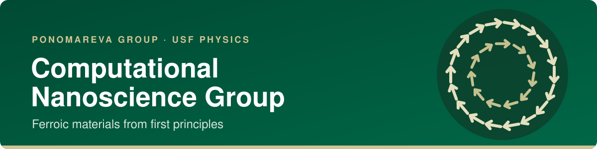

<h3 align="center"><a href="https://www.usf.edu/arts-sciences/departments/physics/research/labs/ponomareva/">Visit the group website →</a></h3>

  <a href="https://www.usf.edu/arts-sciences/departments/physics/research/labs/ponomareva/research.aspx">Research</a> ·
  <a href="https://www.usf.edu/arts-sciences/departments/physics/research/labs/ponomareva/publications.aspx">Publications</a> ·
  <a href="https://www.usf.edu/arts-sciences/departments/physics/research/labs/ponomareva/members.aspx">Members</a> ·
  <a href="https://www.usf.edu/arts-sciences/departments/physics/research/labs/ponomareva/opportunities.aspx">Opportunities</a> ·
  <a href="https://www.usf.edu/arts-sciences/departments/physics/research/labs/ponomareva/contact.aspx">Contact</a>

We are the **Computational Nanoscience Group** in the [Department of Physics](https://www.usf.edu/arts-sciences/departments/physics/) at the University of South Florida, led by Prof. [Inna Ponomareva](https://www.usf.edu/arts-sciences/departments/physics/research/labs/ponomareva/) with Dr. [Sergey Lisenkov](https://ferronest.github.io), Assistant Research Professor. We design computational experiments to uncover the physics behind how materials behave and respond to fields, stress and temperature. Our simulations start from first principles and work bottom-up, at atomistic and nanoscale resolution. The current focus is multifunctional ferroics: ferroelectrics, ferromagnets, ferroelastics and multiferroics.

### Research

<table>
<tr>
<td width="50%" valign="top"> <b>Ferroics and phase transitions</b> Why spontaneous polarization, magnetization or strain appear, and how to tune them for memory and capacitor technologies</td>
<td width="50%" valign="top"> <b>High-frequency dynamics and nanostructures</b> How ferroics respond and switch on time scales from femtoseconds to nanoseconds</td>
</tr>
<tr>
<td width="50%" valign="top"> <b>Caloric effects</b> Temperature changes driven by electric, magnetic or mechanical fields, toward efficient and environmentally friendly cooling</td>
<td width="50%" valign="top"> <b>Methods</b> From density functional theory to classical potentials and machine learning, including simulations in new thermodynamic ensembles</td>
</tr>
</table>

Our work is supported by DOE, NSF, ARO and USF.

### Data and code

The structures and data behind our papers are public in this organization:

- **Antiferroelectrics**: [PZO-Pt-Nanocapacitors](https://github.com/USFmatscilab/PZO-Pt-Nanocapacitors) ([*npj Comput. Mater.* 2025](https://arxiv.org/abs/2402.14176)), [high-strain-polar-phases-PZO](https://github.com/USFmatscilab/high-strain-polar-phases-PZO) ([*Phys. Rev. B* 2020](https://doi.org/10.1103/PhysRevB.102.104101))
- **Molecular and hybrid ferroelectrics**: [TMCM-structures](https://github.com/USFmatscilab/TMCM-structures) ([*Phys. Rev. Lett.* 2020](https://doi.org/10.1103/PhysRevLett.125.207601)), [TMCM-high-press-from-HTP](https://github.com/USFmatscilab/TMCM-high-press-from-HTP) ([*J. Phys. Chem. C* 2021](https://doi.org/10.1021/acs.jpcc.1c03980)), [Inverse-hybrid-perovskite-MA3OI](https://github.com/USFmatscilab/Inverse-hybrid-perovskite-MA3OI) ([*J. Phys. Chem. C* 2021](https://doi.org/10.1021/acs.jpcc.1c01138)), [Hybrid-Formate-Perovskites](https://github.com/USFmatscilab/Hybrid-Formate-Perovskites), [hybrid-formates-from-QE](https://github.com/USFmatscilab/hybrid-formates-from-QE), [Co-Mn-Formate-AFM_G](https://github.com/USFmatscilab/Co-Mn-Formate-AFM_G), [NH2NH3-Co-HCOO_3](https://github.com/USFmatscilab/NH2NH3-Co-HCOO_3)
- **Halide perovskites**: [CGB](https://github.com/USFmatscilab/CGB), [MHyPbX3](https://github.com/USFmatscilab/MHyPbX3), [MPSnBr3-Structures](https://github.com/USFmatscilab/MPSnBr3-Structures)
- **2D materials**: [VSe2-Cr](https://github.com/USFmatscilab/VSe2-Cr)
- **Code**: [FerroPhase-Q](https://github.com/USFmatscilab/FerroPhase-Q), Python tools for polarization hysteresis and real-time dynamics from a 1D quantum model on a DFT energy landscape

### Recent publications

1. [Relaxation approach to quantum-mechanical modeling of ferroelectric and antiferroelectric phase transitions](https://doi.org/10.1038/s41467-026-77563-4), *Nature Communications* **17**, 10883 (2026)
2. [Direct observation of structural disorder near critical point in BaTiO₃ crystal](https://doi.org/10.1103/qhn9-42d5), *Physical Review Letters* **137**, 016102 (2026)
3. [DFT-based insight into finite-temperature properties of ferroelectric perovskites with lone-pair: the case of CsGeX₃ (X = Cl, Br, I)](https://doi.org/10.1088/1361-648X/ae2c2f), *Journal of Physics: Condensed Matter* **38**, 015403 (2026)
4. [Mechanically and electrically tunable Rashba-Edelstein effect in ferroelectric semiconductors, CsGeX₃ (X = I, Br, Cl)](https://doi.org/10.1103/gkt2-x7mm), *Physical Review Materials* **9**, 084412 (2025)

[All publications →](https://www.usf.edu/arts-sciences/departments/physics/research/labs/ponomareva/publications.aspx)

### Join us

We welcome undergraduate and graduate students interested in computational physics and materials. See [Opportunities](https://www.usf.edu/arts-sciences/departments/physics/research/labs/ponomareva/opportunities.aspx) or [get in touch](https://www.usf.edu/arts-sciences/departments/physics/research/labs/ponomareva/contact.aspx).

---

Department of Physics · University of South Florida · 4202 E. Fowler Avenue, Tampa, FL 33620

